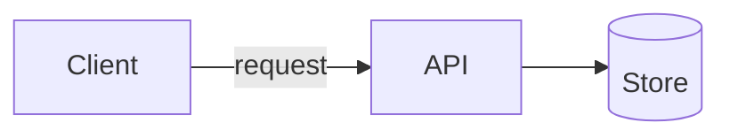

# NNNN. <Decision in a few words>

- Status: proposed | accepted | superseded by [NNNN](NNNN-slug.md)
- Date: YYYY-MM-DD
- Issue: <Linear key or link>

## Context

What forces the decision: the requirement, the constraint, the problem seen.
Facts with dates where they will age (versions, prices, support tables).

## Decision

What we will do, stated so an agent can follow it without reading the rest.

When the decision changes structure, data flow, a boundary, a sequence or a
state machine, draw it in Mermaid (`flowchart`, `sequenceDiagram`,
`stateDiagram-v2`); GitHub renders it and review diffs it as text. Leave it
out when there is nothing to draw, such as a formatter choice.

## Alternatives considered

- **<Option>**: why not, in one or two lines.

## Consequences

What becomes easier, what becomes harder, what we now have to maintain, and
what would make us revisit this.
